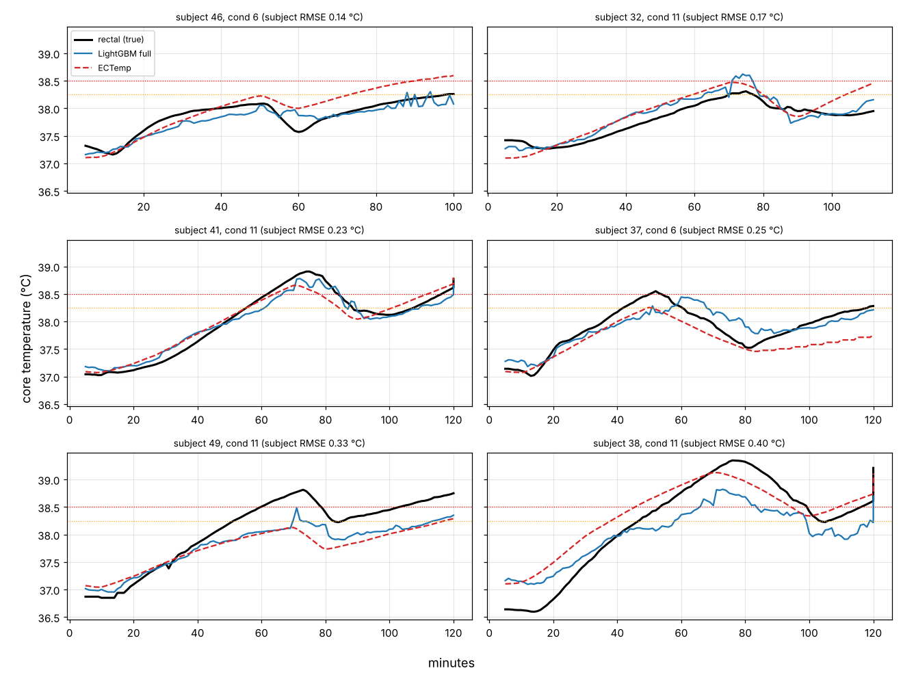

# Early-Heat-Stroke-Warning-Wearable

A low-cost wearable vest/patch that continuously tracks heart rate, skin temperature, sweat activity and ambient heat, then raises an **early warning of heat stress** before physiological collapse occurs. Data streams over Wi-Fi to Firebase, where a companion mobile app shows it live and an ML service estimates core body temperature.

Built by **Team VitaSync**, BM2210 Biomedical Device Design, Dept. of Electronic & Telecommunication Engineering, University of Moratuwa.

> **Not a medical device.** This is a screening / early-warning aid built from simple, adjustable rules and a model trained on public data. It has not been clinically validated and must not be the only safeguard for anyone working in the heat.

---

## 🚨 The Problem

Heat stroke is a severe medical emergency caused by thermoregulatory failure. Current field practice relies on **subjective, symptom-based observation** (sweating status, reported discomfort) rather than continuous data. By the time visible symptoms appear, the person may already be close to collapse.

Consulting a Medical Officer (National Teaching Hospital, Kandy) confirmed the key gaps:

- **Single-indicator risk** - anhidrosis alone isn't a reliable standalone trigger; heart rate and other vitals matter too.
- **Symptom-based, not data-based** - assessments depend on the worker/patient reporting symptoms.
- **Field monitoring gap** - human error, no continuous monitoring, and high equipment cost limit current site-safety practices.

High-risk populations: outdoor laborers (construction, agriculture), military personnel in hot climates, athletes, and the elderly during heatwaves.

**Need statement:**
> "A way to continuously monitor the onset of anhidrosis (sweat cessation) in individuals exposed to high environmental heat or prolonged physical exertion, in order to provide an actionable early warning of heat stroke before systemic physiological collapse occurs."

## 💡 The Solution

A multi-sensor vest. The main node sits at the upper back (C7); the ambient sensor is kept away from body heat. Single sensors fail in the field (sweat floods electrodes, salt crystals keep skin conductive after sweating stops), so the device cross-references several signals:

| Signal | Sensor | Purpose |
|---|---|---|
| Heart rate | MAX30102 reflectance PPG + MPU6050 accelerometer (motion rejection) | Tachycardia / workload, valid even while the wearer is moving |
| Skin temperature | 2 x NTC thermistors (100 kΩ, β = 3950) | Thermal load; one sensor is dropped automatically if it loses contact |
| Sweat level | Ag/AgCl electrodes + 1 kHz lock-in GSR front end | Sweat activity on a 1 - 10 scale; a collapse towards "dry" while hot is the anhidrosis warning |
| Ambient conditions | SHT30 temperature / humidity | Outside temperature and heat index ("feels like") |

Alerts are local (buzzer + LED) and remote (app notifications). On the cloud side, an ML service turns the same data into an **estimated core temperature**, a Physiological Strain Index (PSI) and a risk level.

## 🧩 System Architecture

```
 WEARABLE (ESP32 DevKit V1)                                CLOUD                         PHONE
┌───────────────────────────────────┐          ┌────────────────────────────┐   ┌─────────────────────┐
│ MAX30102 + MPU6050 ─► heart rate  │          │ Firebase Realtime Database │   │ VitaSync Flutter app│
│ 2 x NTC ───────────► skin_temp    │  Wi-Fi   │  /devices/DEV-001/         │──►│ live dashboard,     │
│ SHT30 ─────────────► outside_temp │ ───────► │    skin_temp, heart_rate,  │   │ risk colours,       │
│                       feels_like  │ every 2s │    outside_temp,           │   │ push notifications  │
│ GSR front end ─────► sweat_level  │          │    feels_like_temp,        │   └─────────────────────┘
│                                   │          │    sweat_level             │
│ Buzzer / LED local alert          │          │    prediction  ◄───────────┼── ML service (Python)
└───────────────────────────────────┘          └────────────────────────────┘   core temp, PSI, risk
```

More detail: [`docs/system-architecture.md`](docs/system-architecture.md) (original concept document; the repo has since moved from BLE to Wi-Fi + Firebase and added the ML service).

## 📁 Repository Layout

| Folder | What's inside |
|---|---|
| [`Firmware/`](Firmware) | ESP32 firmware (PlatformIO / Arduino). Sensor drivers, PPG + motion processing, GSR lock-in, Firebase uploader, buzzer logic. |
| [`Hardware/`](Hardware) | Altium Designer project: schematic (`Sheet_BDD.SchDoc`), PCB (`PCB_BDD.PcbDoc`), custom schematic and footprint libraries. |
| [`Manufacturing/`](Manufacturing) | Gerber files (`Heatstroke_Detection_PCB.zip`), schematic PDF, and a STEP model of the GSR circuit PCB. |
| [`ML_Model/`](ML_Model) | Core-temperature model (notebook, shared feature code, trained model) and the live Firebase inference service. |
| [`heat_strock_app/heat_stroke_monitor/`](heat_strock_app/heat_stroke_monitor) | VitaSync Flutter app (Android / iOS). |
| [`docs/`](docs) | Need selection, concept screening and feasibility reports, references, architecture notes. |

## 🔧 Firmware (`Firmware/`)

ESP32 DevKit V1 (ESP32-WROOM-32) running Arduino-ESP32 2.x through PlatformIO. Every sensor uses a small register-level driver in `include/`, so no external libraries are needed.

**Wiring**

| Function | ESP32 pin |
|---|---|
| I2C SDA / SCL (MAX30102 `0x57`, MPU6050 `0x68`, SHT30 `0x44`) | GPIO21 / GPIO22 |
| NTC 1 / NTC 2 | GPIO34 / GPIO35 |
| GSR: DAC excitation / reference switch / electrode switch / ADC | GPIO25 / GPIO16 / GPIO17 / GPIO32 |
| Buzzer (active, HIGH = on) / alert LED | GPIO27 / GPIO2 |

**Key behaviour**

- **Heart rate** from the C7 PPG, with the accelerometer used to identify and remove motion frequencies so HR keeps working while walking, hammering or carrying. Each value carries a 0 - 100 confidence; low-confidence HR is ignored. Details in [`Firmware/README_PPG.md`](Firmware/README_PPG.md).
- **GSR** is measured with a software lock-in at 1 kHz (DAC sine, 20 kS/s sampling on core 0). A 10 kΩ reference path is re-measured every 20 s so gain and phase errors cancel. Output is skin admittance in µS, mapped on a log scale to a **sweat level of 1 - 10**.
- **Skin temperature** is the mean of two NTCs. A sensor that suddenly jumps (lost contact) is dropped; if both are unusable the app receives `ERR: no skin contact` instead of a stale number.
- **Ambient heat index** is computed from the SHT30 temperature and humidity.
- **Upload** runs in its own task and sends five values to Firebase every 2 s. Unavailable values are sent as `null`, never as an old number.
- **Local buzzer alert** (not sent to Firebase) when any of these holds: skin temperature > 40 °C, HR > 120 bpm, HR < 50 bpm (each for 3 s), or sweat level ≤ 1 for 20 s. All limits live in `include/Config.h`.

**Build and run**

1. Open `Firmware/` in VS Code with PlatformIO.
2. Edit `include/Config.h`: set your Wi-Fi credentials (`kWifiSsid`, `kWifiPass`), Firebase host and device ID, and `kFirebaseAuth` if your database rules are not public. Do not commit real credentials.
3. Upload, then open the serial monitor at 115200 baud. Keep the wearer still for about 7 s (motion calibration) and about 10 s more (resting HR).
4. Serial keys: `c` re-calibrate motion, `l` raw log mode, `s` PPG status, `g` GSR / NTC / SHT30 diagnostics.

**Calibrate before trusting the numbers.** Skin-contact NTCs read below core temperature: compare against a clinical thermometer and set `kNtcOffsetC[]` and `kBodyTempOffsetC`. Calibrate the sweat mapping (`kSweatGMinUs`, `kSweatGMaxUs`) on dry and clearly wet skin.

## 🔌 Hardware & PCB (`Hardware/`, `Manufacturing/`)

The custom board carries the ESP32 and the analogue GSR front end: OPA2333 dual op-amp (virtual ground and Sallen-Key filter), 74HC4066 analogue switches for the reference/electrode paths, 100 kΩ series resistor and an AC-coupled electrode path. The Altium project is `Hardware/BDD_Sem03.PrjPcb`; fabrication files are in `Manufacturing/`.

## 🧠 Core-Temperature Model (`ML_Model/`)

Core body temperature cannot be measured non-invasively on a vest, so a LightGBM model estimates it from the vest's own signals (`heart_rate`, `skin_temp`, `outside_temp`, `feels_like_temp`) using 19 causal features: a 5-min personal baseline, 5/10-min means and slopes, 10/30-min EMAs of HR above baseline, and time in session. It was trained on the public **PROSPIE** heat-exposure dataset and tested with nested leave-one-subject-out (LOSO) validation plus an external cohort.

| Model | LOSO RMSE (°C) | External RMSE (°C) |
|---|---|---|
| Constant | 0.533 | 0.572 |
| ECTemp (HR only) | 0.332 | 0.471 |
| **LightGBM (final)** | **0.252** | 0.285 |
| LightGBM, no HR (fallback) | 0.304 | 0.291 |

- **Alarm:** risk is `high` at an estimated core temperature ≥ 38.25 °C and `caution` from 38.0 °C. Against true T<sub>c</sub> ≥ 38.5 °C this catches about 84 % of hot minutes and 96 % of hot trials (LOSO), with 49 % minute-level precision. Most false alarms are near misses.
- **Known limitation:** the model under-reads at the hot end (about -0.4 °C at 39 °C), so do not trust the displayed value above ~39 °C.
- **Not yet validated on this vest:** training data came from healthy subjects in a chamber with different sensors. Expect an offset until the model is calibrated on the team's own sessions with a core-temperature reference.



**Live service.** `ML_Model/service.py` listens to `/devices/DEV-001` in Firebase, builds 1-minute medians, runs the model and writes `/devices/DEV-001/prediction` (`core_temp_est`, `psi`, `risk_level`, `model_used`, `device_status`, `updated_at`). It handles stale devices, missing HR (falls back to a no-HR model) and 60-minute session gaps, and logs raw history to SQLite as future training data.

```bash
cd ML_Model
pip install -r requirements.txt
export FIREBASE_CREDENTIALS=/path/to/service-account.json   # keep this file OUT of the repo
cp config.example.json config.json
python service.py --config config.json                      # live
python service.py --replay examples/replay_example.csv --out replay_out.csv   # no vest needed
```

Full details in [`ML_Model/README.md`](ML_Model/README.md) and results in [`ML_Model/SUMMARY.md`](ML_Model/SUMMARY.md).

## 📱 Mobile App (`heat_strock_app/heat_stroke_monitor/`)

**VitaSync** is a Flutter app (Android / iOS) backed by Firebase Realtime Database.

- Pair with a device by entering its serial number (e.g. `DEV-001`).
- Live dashboard: skin temperature, outside temperature, an animated heart-rate counter, and a 10-level sweat meter.
- Rule-based risk levels: high when skin temperature > 38 °C or HR > 110 bpm; medium for skin 37 - 38 °C or HR 90 - 110 bpm; a separate sweat-failure warning when skin temperature ≥ 38 °C with a low sweat level.
- Medium risk raises a standard notification; high risk raises a priority notification and a full-screen warning dialog with an "Alarm Off" control.

```bash
cd heat_strock_app/heat_stroke_monitor
flutter pub get
flutter run
```

You will need your own Firebase project (Realtime Database) and the matching `google-services.json` / `lib/firebase_options.dart`.

> The app currently reads the five raw device values. The ML service's `prediction` node is written to Firebase but is not displayed in the app yet.

## 🎯 Why This Need (of 5 investigated)

The team evaluated five biomedical device opportunities (heat stroke detection, physiotherapy ROM tracking, CKDu screening, diabetic foot ulcer monitoring, dental caries detection via fluorescence) against Estimated Market, Patient Impact, Provider Impact, Feasibility, and Team Preference. **Heat stroke early detection scored highest (20/25)** - see [`docs/need-selection.md`](docs/need-selection.md) and the full [investigation report](docs/BDD_Investigation_Report.pdf).

## 📚 Documentation

| Document | Contents |
|---|---|
| [`docs/BDD_Investigation_Report.pdf`](docs/BDD_Investigation_Report.pdf) | Need finding for all five opportunities |
| [`docs/need-selection.md`](docs/need-selection.md) | Scoring matrix and the selected need |
| [`docs/Feasibility_Proposal.pdf`](docs/Feasibility_Proposal.pdf) | Concept generation and screening, IP and regulatory considerations (wellness vs. Class II device), testing plan, killer risks, final concept |
| [`docs/Data_collection_investigations_report.md`](docs/Data_collection_investigations_report.md) | Link to the data collection and investigations report |
| [`docs/system-architecture.md`](docs/system-architecture.md) | Original system architecture notes |
| [`docs/references.md`](docs/references.md) | References |

## 👥 Team VitaSync

| Name | Index No. |
|---|---|
| Thennakoon U.I.D. | 240657J |
| Pitiduwa S.M. | 240518K |
| Tennekone A.D.T.M.S.H. | 240642J |
| Wanninayaka W.M.I.R. | 240695X |
| Thiyamini M.W.T. | 240669X |

Course: **BM2210 - Biomedical Device Design**, Dept. of Electronic and Telecommunication Engineering, University of Moratuwa.
